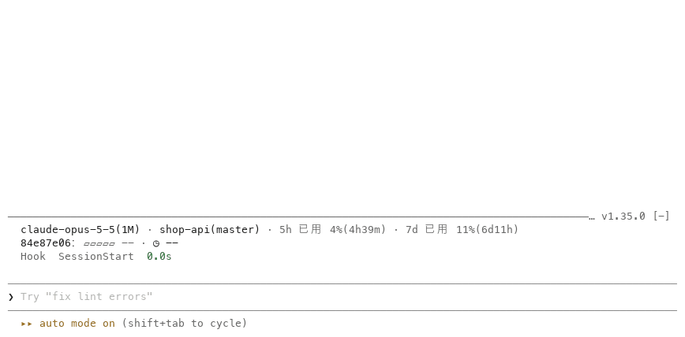
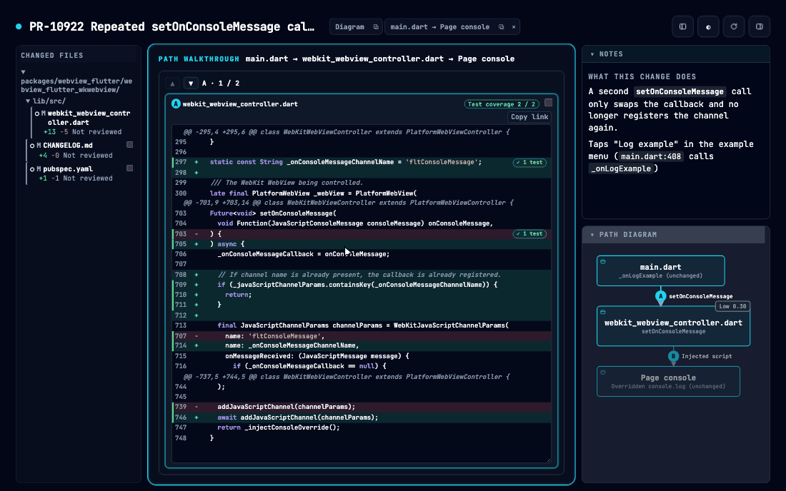

English | [繁體中文](README.zh-TW.md)

# phelix-plugins

Two Claude Code plugins: one keeps your context spending in check, the other turns code review into a diagram you can click through.

```
/plugin marketplace add phelixtw/claude-plugins
/plugin install agent-perform@phelix-plugins
/plugin install archify-review@phelix-plugins
```

## agent-perform

A Claude Mod above the Claude Code prompt that shows, while you type, how much context you have used, how long the Cache has left and how much this turn added. Past 30% it offers one-click `/clear`, `/compact` and `/recap`; it blocks foreground `sleep` polling that re-reads the whole context on every check. A local dashboard at `localhost:8787` drills into every conversation and turn to find where tokens were spent abnormally.



[Read more](plugins/agent-perform/README.md) · Apple Silicon macOS · UI in Traditional Chinese

## archify-review

Reviews a commit, a commit range or a Jira ticket's commits as an explorable HTML report: an architecture diagram of the change, net diffs per flow with each changed function's test coverage marked on the diff and its Given / When / Then cases, reviewed checkboxes that survive reloads, and Code Review / Security / Code Smell TODOs with copyable AI prompts.



**[Try the live demo](https://phelixtw.github.io/claude-plugins/demo/)**, a review of a public flutter/packages PR, no install needed. · [Read more](plugins/archify-review/README.md)

## License

MIT. archify-review is based on the open-source [archify](https://github.com/tt-a1i/archify); see [its LICENSE](plugins/archify-review/LICENSE) and [THIRD_PARTY_NOTICES](plugins/archify-review/skills/archify-review/THIRD_PARTY_NOTICES.md).
