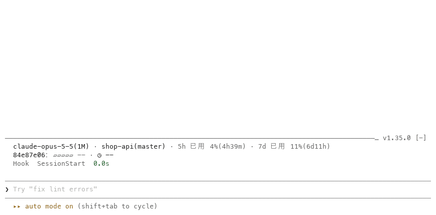
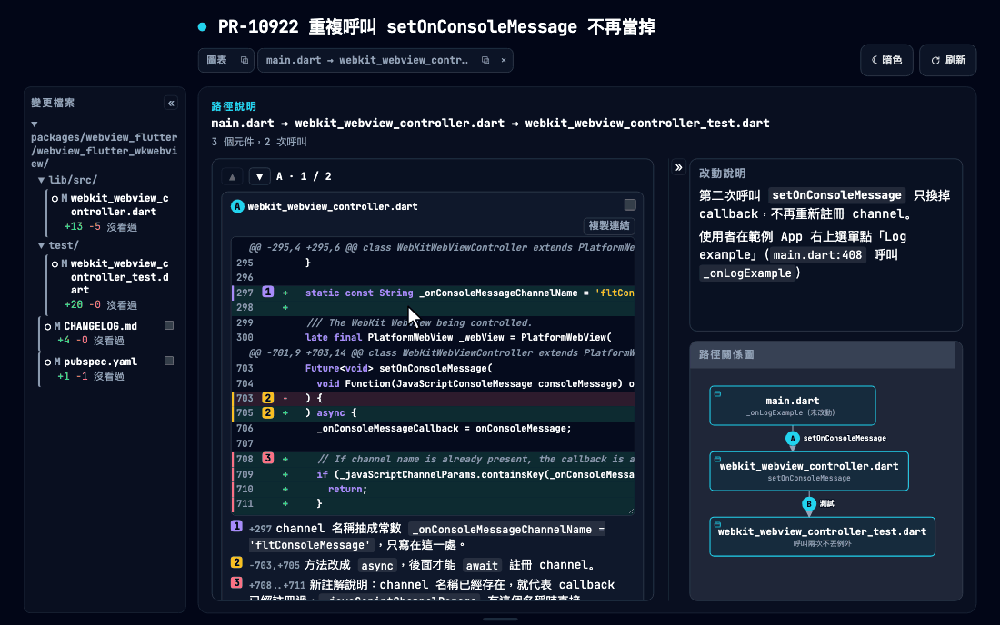

[English](README.md) | 繁體中文

# phelix-plugins

兩個 Claude Code plugin：一個幫你控管 context 的花費，一個把 code review 變成一張可以點的架構圖。

```
/plugin marketplace add phelixtw/claude-plugins
/plugin install agent-perform@phelix-plugins
/plugin install archify-review@phelix-plugins
```

## agent-perform

顯示在 Claude Code 輸入框上方的 Claude Mod，打字時就看得到 context 用了多少、Cache 還剩多久、這個回合漲了多少。超過 30% 時一鍵 `/clear`、`/compact`、`/recap`；前景的 `sleep` 輪詢會被擋下，因為它每檢查一次就重讀整份 context。另附本機後台 `localhost:8787`，可以細看每個對話、每個回合，找出異常的 token 花費。



[完整說明](plugins/agent-perform/README.zh-TW.md) · 需要 Apple Silicon 的 Mac

## archify-review

把一個 commit、一段 commit 範圍或一張 Jira 票的改動，整理成一份可互動的 HTML 報告：改動的架構圖、逐條路徑的淨 diff，每個改到的函式直接在 diff 上標出有沒有測試和 Given / When / Then 案例，看過的勾選重新整理後還在，最後列出 Code Review、Security、Code Smell 待辦，每項都能複製 prompt 交給 AI 修。



**[線上試玩](https://phelixtw.github.io/claude-plugins/demo/zh-TW/)**：一份 Flutter 官方 repo 公開 PR 的報告，不用安裝。 · [完整說明](plugins/archify-review/README.zh-TW.md)

## 授權

MIT。archify-review 以開源的 [archify](https://github.com/tt-a1i/archify) 為基礎，見[它的 LICENSE](plugins/archify-review/LICENSE) 與 [THIRD_PARTY_NOTICES](plugins/archify-review/skills/archify-review/THIRD_PARTY_NOTICES.md)。
