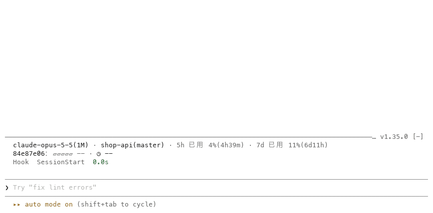
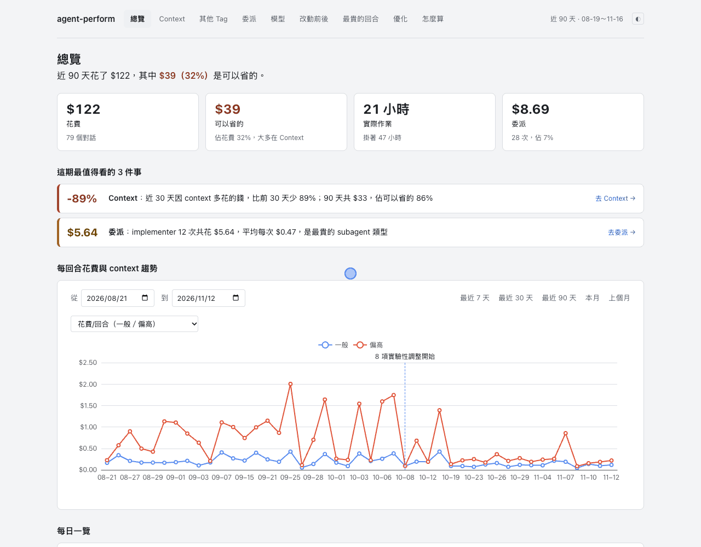

# agent-perform

agent-perform 是一個 Claude Code 的 Claude Mod。它顯示在輸入框上方，讓你隨時看到 context 用了多少、Cache 還剩多久、這個回合 context 漲了多少，幫你控管 context 的支出，養成好習慣。

它同時附一個龐大的後台（`localhost:8787`），可以細看每一個對話、每一個回合，找出異常的 token 花費出在哪裡。一切都在本機讀你的 transcript。



## 安裝：四步

1. 加入 marketplace：

   ```
   /plugin marketplace add phelixtw/claude-plugins
   ```

2. 安裝：

   ```
   /plugin install agent-perform@phelix-plugins
   ```

3. 開一個新 session，輸入：

   ```
   /agent-perform:setup
   ```

   setup 會檢查儀表板與 `bin/ap`，不下載任何模型。

4. 從下一個 session 起，輸入框上方就有 Claude Mod；後台用瀏覽器打開 `http://localhost:8787`。

## Claude Mod：輸入框上方的即時數字

Claude Mod 在輸入框上方顯示即時數字和 Claude Code 正在做的事，Claude CLI 和 Claude Desktop 都看得到。數字在每個回合結束、額度變動時更新，另外每 30 秒刷新一次；正在做的事隨時更新。

- 第一列：模型與 effort、目前資料夾、5 小時與 7 天額度已用百分比和重置倒數。
- 第二列 `<id> › #N：`：點 `<id>` 開儀表板的這個對話頁，點 `› #N` 開這個回合的 pipeline。量表與百分比是 context 用量，後面的 `+86k` 是本回合 context 增加多少，暴增時只有它變警示色。`◷` 是 Cache 還剩多久，過期時反白顯示 `◷ 已過期`。這個回合派了 subagent 時，接著顯示派給誰。花費與浪費改在儀表板看。
- 第三列：Claude 工作時顯示正在做的事（思考、回覆、API、Hook、Read、Write、Bash、Agent，其他工具算 Agent 並標出工具名稱）、指令或路徑、已執行時間。同時有好幾件事在跑時顯示最新的一件和 `+N`，等你允許時顯示 `等待允許`。subagent 裡的動作前面標 `↳名稱`。閒置時改成淡色的最後一筆，也就是上一個回合最後做的事；這個對話還沒做過任何事時不顯示。

點第三列（或按 ctrl+x tab 再按 Enter）打開「執行歷史」面板：這個對話最近 500 筆，/clear 後重新開始。終端寬度 110 欄以上的全螢幕模式停靠在對話右側，其他時候出現在輸入框上方。每筆是時間、類別、指令和執行時間；執行時間綠色是成功，紅色是失敗、錯誤、被拒絕或中斷。打開時鍵盤直接交給面板，焦點在最新一筆，↑↓ 移動，Enter 在儀表板開那一筆：工具呼叫直接捲到那一列並顯示它的總花費，其他的開那個回合或那個 subagent 的頁面。按 Esc 或面板右上的 ✕ 關掉。打開時新進來的接在下面，已在畫面上的不會移動；面板放滿後底部顯示 `↓ N 筆新`，往下一次捲一筆、數字跟著減少，按它直接跳到最新一筆。

## 它幫你養成的習慣

- **context 長了就整理。** Context 達 30% 以上時，Mod 多一列 `/clear`、`/compact`、`/recap`，點一下就執行，按 ✕ 可關掉。
- **看到警示色就停一下。** context 超過視窗 40%、Cache 剩不到 5 分鐘、本回合 context 暴增（是平常的 5 倍以上，且多出 50k 以上）時，那一格變警示色；Cache 過期時反白顯示 `◷ 已過期`。
- **趁 Cache 還在時接著做。** `◷` 倒數 Cache 還剩多久；過期後的第一次 API 呼叫要重寫整份 context。
- **不在前台空等。** 主對話用 `sleep` 前景輪詢會被擋下，Claude 改用 `run_in_background`（5 秒以內的 `sleep`、背景指令與 subagent 不受影響）。
- **閒置太久自動收尾（選用）。** 打開 `autoCompact` 後，context 在 60% 以上且閒置一小時，會先 `/recap` 再 compact。

## 後台：找出異常的 token 花費

後台在 `http://localhost:8787`，從總覽一路點到單一回合，看每個對話、每個回合花了多少、context 裡裝了什麼、哪裡多花了錢。


下面的畫面都是用虛構的 transcript 錄的，不是真實資料。

### 第一次打開，照這個順序看

1. **總覽**：先看頂端一句話，知道這段期間花了多少、有幾類問題。預設看近 90 天，右上可改成 7 天、30 天、本月、上個月或自選日期。
2. **一個主題頁**：點問題清單的某一列（例如 Context）。主題頁會把有這個問題的列排到最前面並標亮，其他列變淡。點進去的對話和回合也會帶著同一個聚焦。

   

3. **對話與單日**：在總覽的每日一覽點某一天，再點某個對話，看逐回合的花費、最大 context、用了哪些工具，以及 Tag 標出的問題。
4. **單一回合**：點任一回合，看這個回合的花費、可以省的地方，以及 context window 裡裝了什麼（可依來源、依次數、依 API 呼叫切換）。

   

### 每一頁回答什麼問題

| 頁面 | 回答的問題 |
| --- | --- |
| 總覽 | 這段期間錢花在哪裡？有哪幾類問題？ |
| Context | 哪些對話或回合的 context 太長？ |
| 其他 Tag | 哪些臨時腳本、重複呼叫、撞到工具上限的呼叫多花了錢？ |
| 委派 | subagent 花了多少？划不划算？ |
| 模型 | 各模型花了多少？便宜的活有沒有被貴的模型做掉？ |
| 改動前後 | 我改了設定之後，花費有沒有變好？ |
| 最貴的回合 | 我打的哪幾句話用掉最多 token？ |
| 優化 | 我的 CLAUDE.md、rules、skills 和已裝 plugin 有沒有過時或互相矛盾的指示？（按下才跑 `/claude-api prompt-audit`，用訂閱額度，只給建議不改檔） |
| 怎麼算 | 每個數字怎麼來、何時更新、資料在哪個檔案？ |


### 改了設定之後有沒有變好

改了 CLAUDE.md、裝了 skill 或換了模型之後，想知道有沒有省到錢，到「改動前後」。

1. 在圖上點改動那一天的長條，那一天立刻成為改動日。
2. 長條旁會跳出小卡片，顯示那天的每回合花費、回合數，以及偵測到的設定變更。
3. 「每一項改了多少」表格原地重算，不會重新載入頁面，更新時畫面變淡並顯示「更新中…」。每一列是一個指標，顯示改動前、改動後，以及差距是不是超出隨機波動。
4. 改動日前或後任一邊不足 7 天的資料時，頁面會說明資料不夠，不顯示表格。

頁尾會列出從 transcript 自動偵測到的設定變更（CLAUDE.md 改了哪幾行、裝或移除了哪些 skill 與 MCP、主要模型換了），任何一天都可以設成改動日。


## 資料從哪來、存在哪

- 一切在本機執行。儀表板（`localhost:8787`）只監聽 `127.0.0.1`，plugin 不把對話送出機器。
- 對外連線只有一個，不帶對話內容：每天一次從 Anthropic 官方文件抓模型價格（失敗時每小時重試）。
- 「優化」頁按下時會跑 `claude -p`，用的是你的訂閱額度。Stop hook 在設定改變後會跑一次 `claude -p "/context"`，記下 context 各分類的大小。
- 儀表板讀 Claude Code 自己的 transcript：`~/.claude/projects/<工作目錄>/<session id>.jsonl`，以及 `subagents/` 底下的檔案。plugin 不另存完整對話。
- plugin 自己寫的檔案（在 `~/.claude/` 下）只留判斷結果、數字和找回原文用的定位資訊，不存輸入文字。例外是儀表板的頁面快取與解析快取，裡面有頁面上看得到的開頭文字。
- 能往回看多久取決於 Claude Code 的 `cleanupPeriodDays`（`~/.claude/settings.json`，預設 30 天，更舊的 session 會被刪）。要看更久，自己調大，例如 `{ "cleanupPeriodDays": 120 }`。plugin 不讀也不寫這個設定。
- 儀表板的刪除按鈕會清掉該對話的委派紀錄，並把 transcript 移到垃圾桶。

## 常見問題

**打不開 `http://localhost:8787`，或看不到 Claude Mod。** 輸入 `/agent-perform:setup`，它會檢查儀表板與 `bin/ap`。

**只看得到約 30 天的資料。** 這是 `cleanupPeriodDays` 的預設值，見上一節。

**主對話的 `sleep` 輪詢被擋下。** 這是設計：前景輪詢每次都是一次 API 呼叫、重讀整份 context。請改用 `run_in_background`。5 秒以內的 `sleep`、背景指令與 subagent 不受影響。

**想檢查整個 Claude Code 環境。** `/agent-perform:doctor` 會唯讀檢查 settings、CLAUDE.md、rules、skills、hooks、subagents、permissions，列出可以改的項目。

## 需求

- Apple Silicon Mac（darwin/arm64）。`bin/ap` 只編了這個平台，其他平台上 poll gate、Claude Mod 與 context 讀數都會停用。
- 不需要 python3、venv 或 torch。
- 埠號 8787（儀表板）。

## 進階

細節在儀表板的「怎麼算」頁，這裡只列幾項。

- **自動 compact**：`plugin.json` 的 `userConfig.autoCompact`，預設關閉。開啟後，context 在 60% 以上且閒置一小時，會先 `/recap` 再 compact。
- **閒置釋放記憶體**：連續 5 分鐘沒有人開頁面，服務會把算好的頁面存到磁碟並重啟自己。頁面開著時每 3 分鐘自動重新整理，不看時請關掉分頁。
- **遮蔽機密**：儀表板顯示對話內容前，會把 API key、token、`Authorization` 標頭、網址裡的密碼等格式遮掉，存到磁碟的頁面快取也是遮掉後的內容。只比對這些格式，不保證擋下所有機密。
