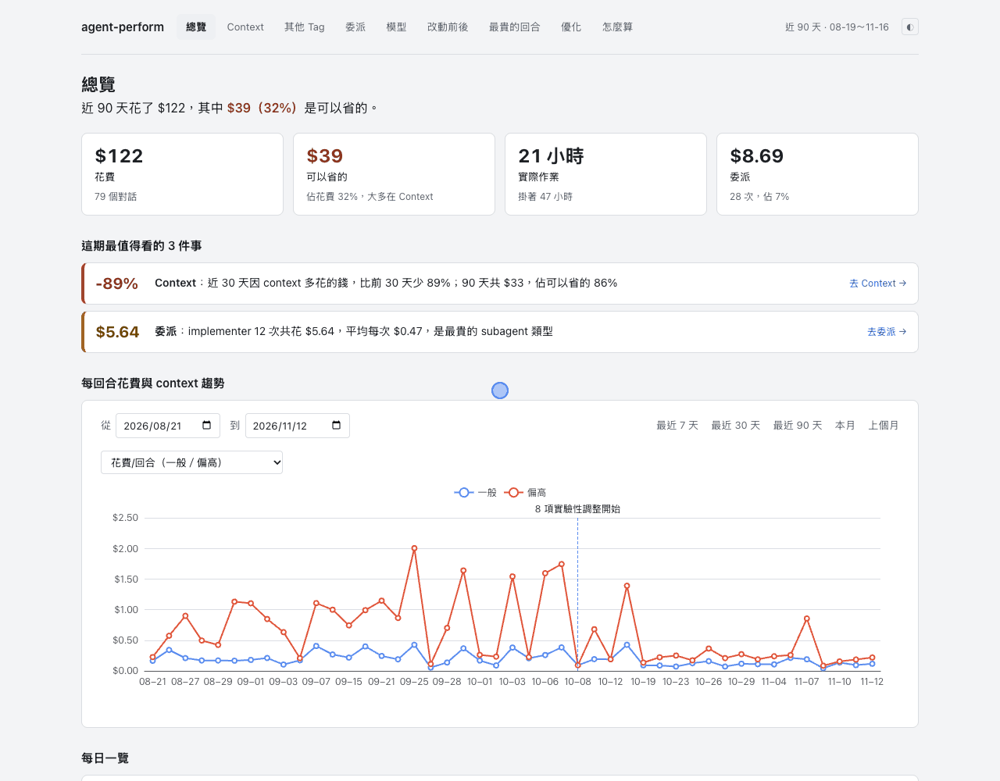
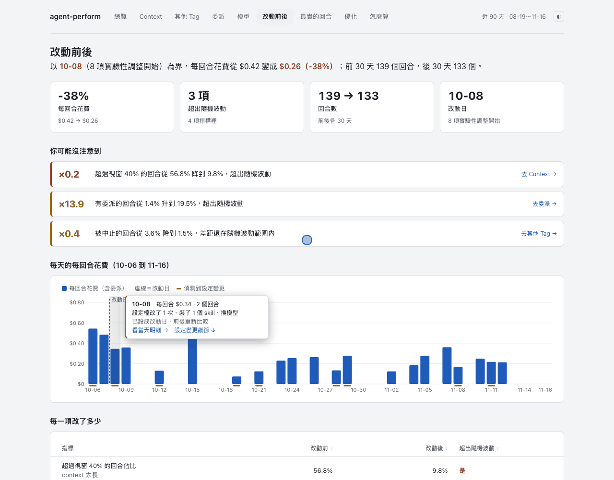

English | [繁體中文](README.zh-TW.md)

# agent-perform

agent-perform is a Claude Mod for Claude Code. It sits above the prompt and shows, at all times, how much context you have used, how long the Cache has left, and how much context this turn added. It keeps your context spending in check and helps you build good habits.

It also comes with a large dashboard at `localhost:8787` that lets you drill into every conversation and every turn to find where tokens were spent abnormally. Everything runs locally, reading your own transcripts.


## Install in four steps

1. Add the marketplace:

   ```
   /plugin marketplace add phelixtw/claude-plugins
   ```

2. Install the plugin:

   ```
   /plugin install agent-perform@phelix-plugins
   ```

3. Start a new session and run:

   ```
   /agent-perform:setup
   ```

   Setup checks the dashboard and `bin/ap`. It does not download any models.

4. From the next session on, the Claude Mod appears above the prompt. Open the dashboard in your browser at `http://localhost:8787`.

Before you install, note two things:

- **The UI is in Traditional Chinese.** All text in the Mod and the dashboard is Traditional Chinese. This README gives an English gloss for each label the first time it appears.
- **Apple Silicon macOS only.** `bin/ap` is prebuilt for darwin/arm64 only. On any other platform the poll gate, the Claude Mod and the context readings are turned off. See [Requirements](#requirements).

## The Claude Mod: live numbers above the prompt

The Claude Mod shows live numbers and what Claude Code is doing right now, above the prompt in both the Claude CLI and Claude Desktop. The numbers update at the end of each turn, whenever your quota changes, and every 30 seconds. The current activity updates continuously.

- **Row 1:** model and effort, current folder, percentage used of the 5-hour and 7-day quotas, and the countdown to each reset.
- **Row 2, `<id> › #N`:** click `<id>` to open this conversation in the dashboard, or `› #N` to open this turn's pipeline. The gauge and percentage show context use. The `+86k` after it is how much context this turn added; when it spikes, only that number turns the warning colour. `◷` is how long the Cache has left; once it expires it shows inverted as `◷ 已過期` (expired). If this turn dispatched a subagent, it then shows which one. Cost and waste live in the dashboard instead.
- **Row 3:** while Claude works, what it is doing (thinking, replying, API, Hook, Read, Write, Bash, Agent; any other tool counts as Agent and is labelled with the tool name), the command or path, and elapsed time. When several things run at once it shows the latest one plus `+N`. While waiting for your approval it shows `等待允許` (waiting for permission). Actions inside a subagent are prefixed with `↳name`. When idle it shows the last entry, dimmed: the last thing the previous turn did. In a conversation that has not done anything yet, the row is empty.

Click row 3 (or press ctrl+x tab, then Enter) to open the 「執行歷史」 (run history) panel: the 500 most recent entries for this conversation, starting over after /clear. In fullscreen mode with a terminal at least 110 columns wide it docks to the right of the conversation; otherwise it appears above the prompt. Each entry shows the time, category, command and elapsed time. Elapsed time is green for success and red for failure, error, denial or interruption.

When the panel opens it takes the keyboard, with focus on the newest entry. ↑↓ move, and Enter opens that entry in the dashboard: a tool call scrolls straight to its row and shows its total cost; anything else opens that turn's or that subagent's page. Esc or the ✕ in the top right closes it. New entries append at the bottom while it is open, and entries already on screen stay put. Once the panel is full, the bottom shows `↓ N 筆新` (N new); each scroll down moves one entry and lowers the count, and clicking it jumps to the newest entry.

## Habits it builds

- **Tidy up when context grows.** At 30% context or more, the Mod adds a row with `/clear`, `/compact` and `/recap`. Click one to run it, or ✕ to dismiss the row.
- **Pause when you see the warning colour.** A cell turns the warning colour when context passes 40% of the window, when the Cache has under 5 minutes left, or when this turn's context spikes (5 times the usual growth or more, and at least 50k extra). An expired Cache shows inverted as `◷ 已過期`.
- **Keep going while the Cache is warm.** `◷` counts down the Cache's remaining time. The first API call after it expires rewrites the whole context.
- **Don't wait in the foreground.** Foreground `sleep` polling in the main conversation is blocked, so Claude uses `run_in_background` instead. A `sleep` of 5 seconds or less, background commands and subagents are not affected.
- **Wrap up after a long idle (optional).** With `autoCompact` turned on, once context is at 60% or more and the session has been idle for an hour, it runs `/recap` and then compacts.

## The dashboard: find abnormal token spend

The dashboard lives at `http://localhost:8787`. Click from the overview all the way down to a single turn to see what each conversation and each turn cost, what was in the context, and where money was overspent.



All recordings below use made-up transcripts, not real data.

### Your first visit, in this order

1. **總覽 (Overview):** start with the one-line summary at the top: how much this period cost and how many kinds of problems were found. The default range is the last 90 days; switch to 7 days, 30 days, this month, last month or a custom range in the top right.
2. **A topic page:** click a row in the problem list (for example Context). The topic page moves the rows with that problem to the top and highlights them, dimming the rest. Conversations and turns you open from there keep the same focus.

   

3. **Conversations and a single day:** in the overview's daily view, click a day, then a conversation, to see per-turn cost, peak context, the tools used, and the problems flagged by Tags.
4. **A single turn:** click any turn to see its cost, where you could save, and what was in the context window (switchable by source, by count, or by API call).

   

### What each page answers

| Page | Question it answers |
| --- | --- |
| 總覽 (Overview) | Where did the money go this period? What kinds of problems are there? |
| Context | Which conversations or turns have too much context? |
| 其他 Tag (Other tags) | Which throwaway scripts, repeated calls, and calls that hit tool limits cost extra? |
| 委派 (Delegation) | How much did subagents cost? Were they worth it? |
| 模型 (Models) | What did each model cost? Was cheap work done by an expensive model? |
| 改動前後 (Before and after) | After I changed my setup, did spending improve? |
| 最貴的回合 (Most expensive turns) | Which of my prompts used the most tokens? |
| 優化 (Optimize) | Do my CLAUDE.md, rules, skills and installed plugins have outdated or conflicting instructions? (Runs `/claude-api prompt-audit` only when you press the button, uses your subscription quota, and only suggests changes without editing files.) |
| 怎麼算 (How it's calculated) | Where does each number come from, when is it updated, and which file holds the data? |


### Did your setup change help?

After editing CLAUDE.md, installing a skill or switching models, go to 「改動前後」 (Before and after) to see whether you saved money.

1. Click the bar for the day of the change in the chart. That day becomes the change date right away.
2. A small card pops up next to the bar with that day's cost per turn, number of turns, and any setup changes detected.
3. The 「每一項改了多少」 (how much each metric changed) table recalculates in place without reloading the page; while it updates, the view dims and shows 「更新中…」 (updating). Each row is one metric, showing before, after, and whether the difference is beyond random noise.
4. If either side of the change date has less than 7 days of data, the page says there is not enough data and shows no table.

The footer lists setup changes detected automatically from transcripts (which lines of CLAUDE.md changed, which skills and MCP servers were installed or removed, and changes of main model). Any day can be set as the change date.



## Where the data comes from and where it lives

- Everything runs locally. The dashboard (`localhost:8787`) listens only on `127.0.0.1`, and the plugin never sends conversations off your machine.
- There is exactly one outbound connection, and it carries no conversation content: once a day it fetches model prices from Anthropic's official docs (retrying hourly on failure).
- Pressing the button on the 優化 (Optimize) page runs `claude -p`, which uses your subscription quota. After a settings change, the Stop hook runs `claude -p "/context"` once to record the size of each context category.
- The dashboard reads Claude Code's own transcripts: `~/.claude/projects/<working directory>/<session id>.jsonl` and the files under `subagents/`. The plugin does not keep its own copy of full conversations.
- Files the plugin writes itself (under `~/.claude/`) hold only numbers and location data for finding the original text again; they do not store what you typed. The exception is the dashboard's page cache and parse cache, which contain the opening text visible on its pages.
- How far back you can look depends on Claude Code's `cleanupPeriodDays` (in `~/.claude/settings.json`, default 30 days; older sessions are deleted). To keep more history, raise it yourself, for example `{ "cleanupPeriodDays": 120 }`. The plugin neither reads nor writes this setting.
- The dashboard's delete button clears that conversation's delegation records and moves its transcript to the Trash.

## FAQ

**`http://localhost:8787` won't open, or the Claude Mod doesn't show.** Run `/agent-perform:setup`; it checks the dashboard and `bin/ap`.

**I can only see about 30 days of data.** That is the default `cleanupPeriodDays`; see the previous section.

**`sleep` polling in the main conversation gets blocked.** That is by design: every foreground poll is an API call that rereads the whole context. Use `run_in_background` instead. A `sleep` of 5 seconds or less, background commands and subagents are not affected.

**I want to check my whole Claude Code setup.** `/agent-perform:doctor` does a read-only check of settings, CLAUDE.md, rules, skills, hooks, subagents and permissions, and lists what you could change.

## Requirements

- An Apple Silicon Mac (darwin/arm64). `bin/ap` is built for this platform only; on any other platform the poll gate, the Claude Mod and the context readings are turned off.
- No python3, venv or torch needed.
- Port 8787 (dashboard).

## Advanced

The dashboard's 怎麼算 (How it's calculated) page has the details; only a few items are listed here.

- **Auto compact:** `userConfig.autoCompact` in `plugin.json`, off by default. When on, once context is at 60% or more and the session has been idle for an hour, it runs `/recap` and then compacts.
- **Freeing memory when idle:** after 5 minutes with no page open, the service saves its computed pages to disk and restarts itself. Open pages refresh automatically every 3 minutes, so close the tab when you are not looking at it.
