English | [繁體中文](README.zh-TW.md)

> Install: `/plugin marketplace add phelixtw/claude-plugins`, then `/plugin install archify-review@phelix-plugins`, and install code-review-graph with `uv tool install code-review-graph` (CLI only; do not run its `install` subcommand, which rewrites the target repo's `.mcp.json`, `.claude/` and `CLAUDE.md`). Usage: `/archify-review`. `review-kit` ships binaries for macOS (arm64, x86_64) and Linux (amd64, arm64); other platforms need Go, and Windows needs WSL or Git Bash. The `visual-check` that runs after a report is generated needs Chrome or Chromium (set `ARCHIFY_CHROME` if it is not found).

# Archify Review: code review reports

The `/archify-review` skill (built on the open-source archify) turns the commits of a Jira ticket (for example PROJ-123) into one interactive HTML file: an architecture diagram, a diff walkthrough for each path, and a list of open questions.

## Where reports live

All reports share one page, `~/archify-review/review.html`. Each ticket adds a single data file, `~/archify-review/reports/<ticket>.js`, which holds its diagram, file tree, diffs, notes and open questions. Open `review.html?report=PROJ-123` and change the ticket key to switch reports. To keep a version, copy that ticket's `.js` file.

## Why

It draws a ticket's or a commit range's changes as an interactive architecture diagram, so the reviewer (usually an engineer) can follow the flow and read the diffs one step at a time. Review findings land in three lists, Code Review, Security and Code Smell, and each item copies a ready-made prompt for an AI agent to fix it. Reviewers no longer have to piece together what changed and why before they can start; they go from the diagram and its notes straight into the code.

## Features

1. Takes a Jira ticket, a commit, or a commit range (`<sha1>..<sha2>`). For a Jira ticket it also reads the Figma, localization and GA details on the parent Story, but the notes stay focused on what this ticket changes. A large range is split into features users can see, reviewed one at a time, and only the code that survives to the end of the range is shown.
2. A changed-file tree next to the architecture diagram. App projects use an MVVM layout by default, with Flutter and WebView layouts to switch to.
3. Walk each path's diffs with test coverage drawn on the diff itself: a bar beside each changed function's lines shows whether it is tested, and a chip on its first line opens why it matters, which tests cover it, and their Given / When / Then cases; untested functions get suggested cases. Test files never appear in the report. A file changed by several commits shows one net diff.
4. Every diff has a "reviewed" checkbox, and the file tree tracks review progress. The state lives in the browser, so it survives a reload, closing the tab, or switching to another ticket and back.
5. Review findings are split into Code Review, Security and Code Smell tabs, sorted by risk. LOW items have an "AI Fix" button and MEDIUM and above an "Ask AI" button; both copy a prompt.
6. Every location has a copyable reference link, so you can point an AI agent or a teammate at that exact code or view.
7. Light and dark themes, following the system by default; `visual-check` checks the layout after each report is generated.
8. Every node with changed files carries a blast-radius badge in its top-right corner (high / medium / low plus a score, computed by [code-review-graph](https://github.com/tirth8205/code-review-graph)). Click the node and the popover's "Blast radius" tab lists the score breakdown, the impacted callers and the functions missing tests.

## How to use it

### 1. Start with the big picture

Open the HTML and look at the main diagram first: which components this change touches and how they call each other. Click any node to see its role, its task in this change, and the concepts you need to know.

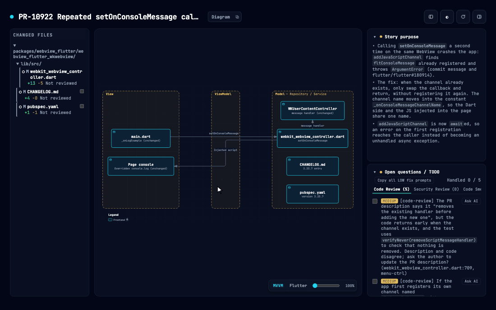

*Click a node to see what that component does in this change.*

The animations on this page use a report generated from PR #10922 of the open-source [flutter/packages](https://github.com/flutter/packages) (commit `12b43a192e`, which fixes a crash when `setOnConsoleMessage` is called twice).

### 2. Read the story's purpose

The "Story purpose" card at the top of the right column explains the problem the ticket solves. Read it first, so you know which changes in the diffs are intentional.

### 3. Work through the open questions

The "Open questions / TODO" card below it lists what the AI found while building the report and needs a human to decide. To build this list, the skill first switches to the task's repo and branch (it remembers the original branch and switches back afterwards; if the working tree has uncommitted changes it never stashes or discards them, but asks you, and if it cannot ask it skips `/security-review` and says so in the list). It then sends subagents to run Claude Code's built-in `/code-review` and `/security-review` on the same commits, plus an over-engineering pass based on the bundled [ponytail-review](https://github.com/DietrichGebert/ponytail) (MIT) rules, and collects their findings here. Tabs at the top of the card switch between Code Review, Security Review and Code Smell. Code Smell only picks code that can be deleted, hand-written code that a standard library or platform feature can replace, and abstractions with a single implementation; each item is graded by how risky the change is and says what to cut and what replaces it.

Every item has a severity label (high / medium / low; `review-check` validates severity and ordering) and the list is sorted from high to low. Each item also names its `file:line` and the flow it belongs to (`connection id`). The point of the list is to collect open questions for the reviewer to decide on, not to hand down verdicts. Where `/code-review` or `/security-review` are not available (for example in Codex), they are skipped and the list says so.

Each item has a checkbox; ticking it means it has been handled. LOW items have an "AI Fix" button and MEDIUM and above an "Ask AI" button. Both copy a prompt with the problem, its file and line, and fix instructions for an AI coding agent, and show a confirmation (the card also has "Copy all LOW fix prompts", which copies only the current tab's items). The "Handled N / M" count in the top-right corner follows your ticks.

On a wide enough screen (1100px and up) both cards sit to the right of the diagram, so the diagram can use the full height. The ▾ before each card title collapses that card and the other one takes its space; the panel icon at the right end of the toolbar collapses the whole right column. Collapsed state is remembered. On narrower screens the cards sit below the diagram. Ticks are stored in the browser's localStorage and survive a reload (see "State is kept" below).

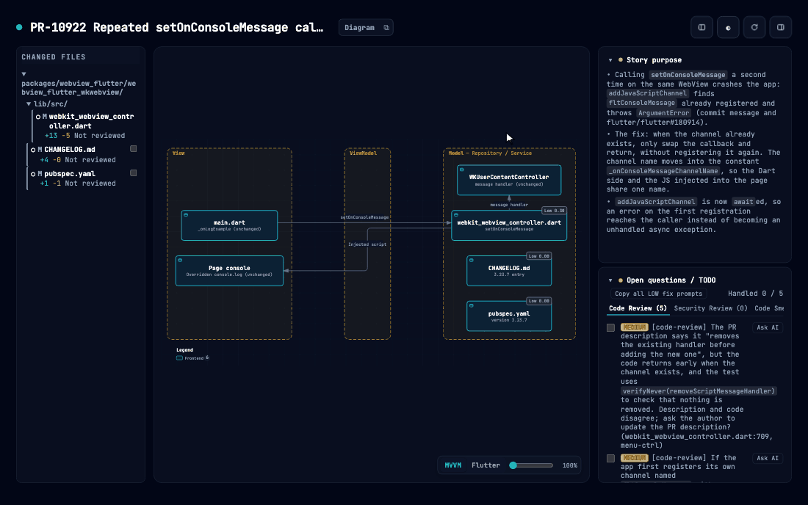

*Items carry severity labels. "AI Fix" on a LOW item copies its prompt and shows "Copied"; ticking two items moves the count to 2 / 5.*

### 4. Check each code change

The changed-file tree on the left marks each file "Not reviewed", "Partly reviewed" or "Reviewed". A file's state follows the flows that reference it: once those flows are ticked, the file is reviewed. Files no flow references (such as CHANGELOG.md) have a checkbox of their own.

The panel icon at the left end of the toolbar collapses the file tree to give its width to the diagram or the diff; press it again to bring the tree back.


*Collapse the file tree and the diff gets wider; press again to expand it.*

Click a path (connection) or a node on the main diagram, and "View changes" in its popover opens a new tab dedicated to that path. A node's popover only lists its files and what changed in them; the diffs are in the tab.

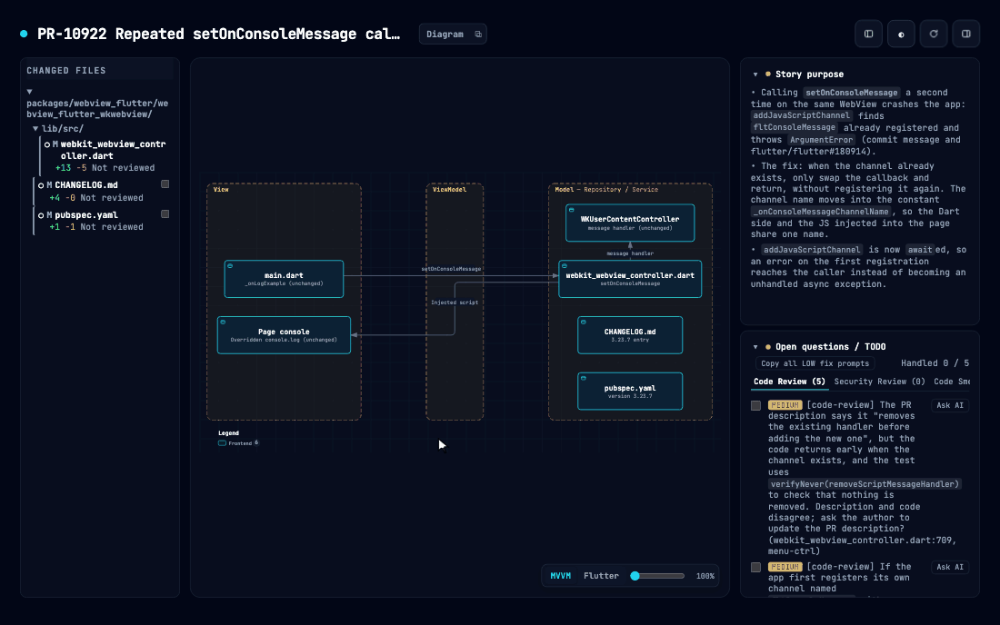

*Click a connection, then "View changes".*

In a path tab, every segment (A, B, C...) has a "reviewed" checkbox at the top right of its diff, and its title is the diff's file name. Ticking it updates the file tree on the left right away and moves on to the next segment. A file whose diff belongs only to a node on the diagram, with no connection, is appended to the path as its last segment, with a checkbox of its own.

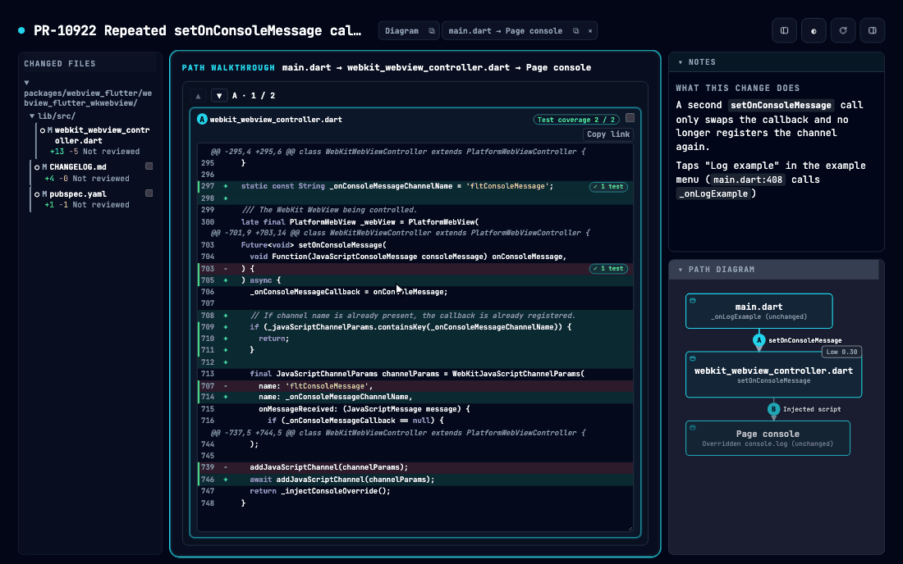

*Tick the segments one by one: the file on the left goes from "Not reviewed" to "Partly reviewed" to "Reviewed".*

A node with no connections (for example one that only changes CHANGELOG.md or pubspec.yaml) can also be opened in a tab from its popover. The tab holds its diff and checkbox, and the right column summarizes the file. Clicking such a file's name in the file tree opens its tab directly.

A path tab's right column holds "Notes" and "Path diagram", in the same place as the cards on the diagram tab. The ▾ before each heading collapses that section; the panel icon at the right end of the toolbar collapses the whole right column to give the diff more width. All path tabs share the same collapsed state.

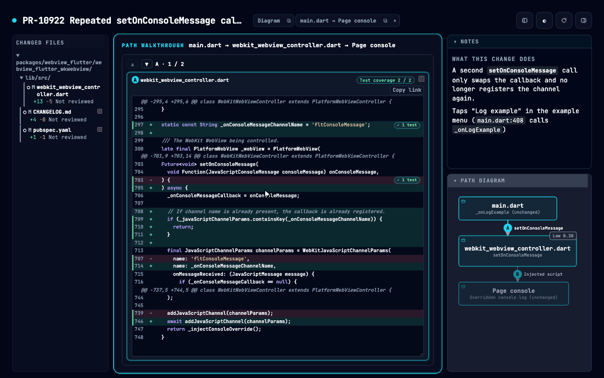

*Collapse the right column with its notes and path diagram, and the diff gets wider; press again to expand it.*

With both the file tree and the right column collapsed, the diff switches to side by side: the old version on the left with old line numbers, the new version on the right with new line numbers, deleted and added lines aligned. Expand either side to return to the single-column diff. Copying links and ticking work the same in both modes.

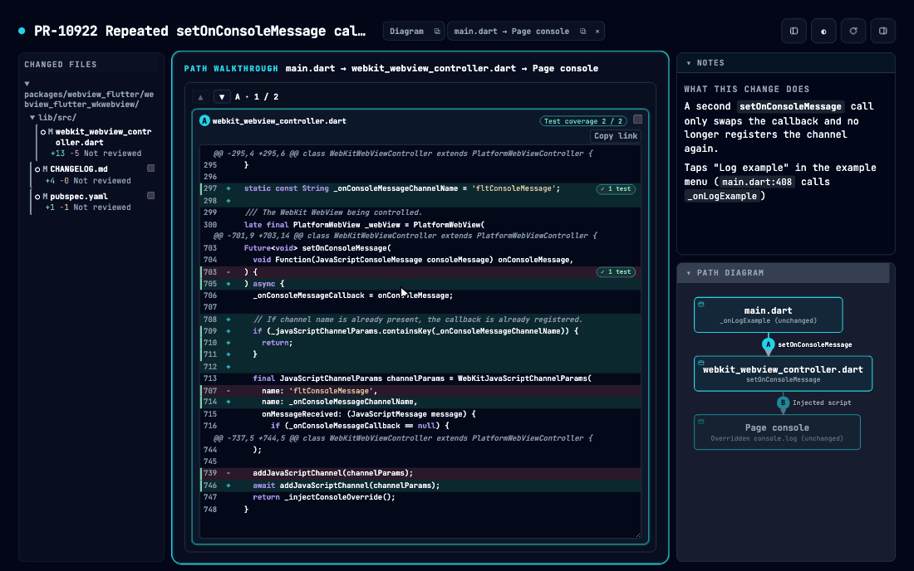

*Collapse the file tree, then the right column, and the diff turns into old-left / new-right; expanding the file tree brings back the single column.*

#### Test coverage on each diff

Test coverage is drawn right on the diff. Every changed function gets a bar beside its lines: green when it is tested (by a new or an existing test), red over a light red hatch when it is not, grey when it was removed, so untested code stands out at a glance. The first line of each function carries a small chip at its right end (`✓ 1 test`, `✗ No test`, `Removed`). Clicking it opens a popover beside that line: "Why test it:" comes first and says who is affected if the code is wrong; then each test is written as three lines, Given / When / Then, with "via" and a function name when the test only reaches the code indirectly; untested functions list "Suggested test cases". Esc or a click elsewhere closes it, and neither opening nor closing scrolls the page. "Test coverage N / M" in the file-name row counts the segment's tested functions; it is green when all are tested and orange otherwise. Nothing is listed below the diff. Test files are not drawn as nodes, not listed in the file tree and get no diff of their own; review comments on test code still go to the open-questions list.

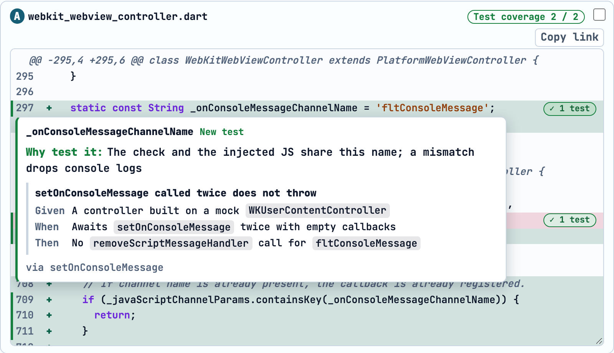

*Both changed functions in `setOnConsoleMessage` have a new test. The chip on the constant `_onConsoleMessageChannelName` opens why it matters, the test's Given / When / Then, and that it is reached via `setOnConsoleMessage`.*

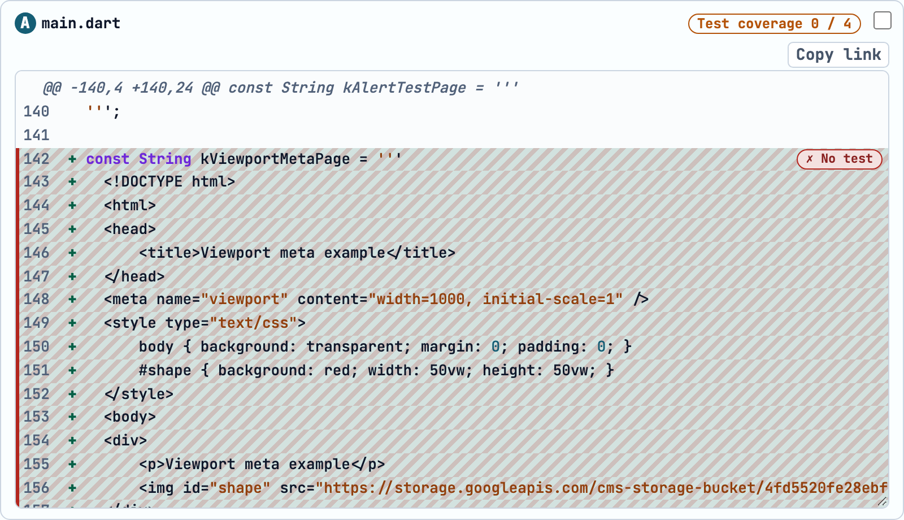

*None of the code added to the example app is tested: the whole segment is hatched red, the chip reads "No test", and the file-name row shows "Test coverage 0 / 4".*

#### Switch segments with A / B / C

A path can span several files. The A, B, C markers on the "Path diagram" at the bottom right are the segments; click one to jump to its diff, or step through them with the ▲ / ▼ next to `A · 1 / 2`.


*Click B, then A, on the path diagram and the diff on the left follows. Each segment shows its test coverage; the chip beside a function opens its Given / When / Then.*

#### What changed and how files work together

"What this change does" at the top right says in a sentence or two what the segment changes and where a user triggers it. A segment that spans two files adds "How they work together", which explains how the two files cooperate in this change, with the real function names and values. Read it first when a diff is hard to follow.

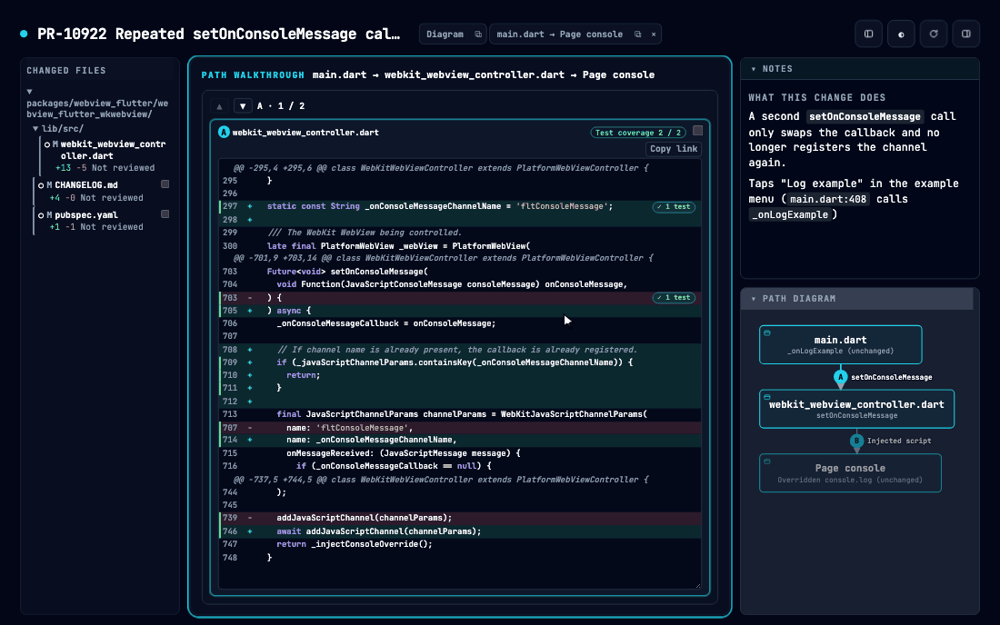

*Segment A only has "What this change does"; switching to B adds "How they work together".*

### State is kept

Reviewed ticks and open-question ticks are stored in the browser's localStorage, one set per ticket. They survive a reload, closing and reopening the tab, and switching to another ticket and back; only another browser or clearing browsing data removes them.

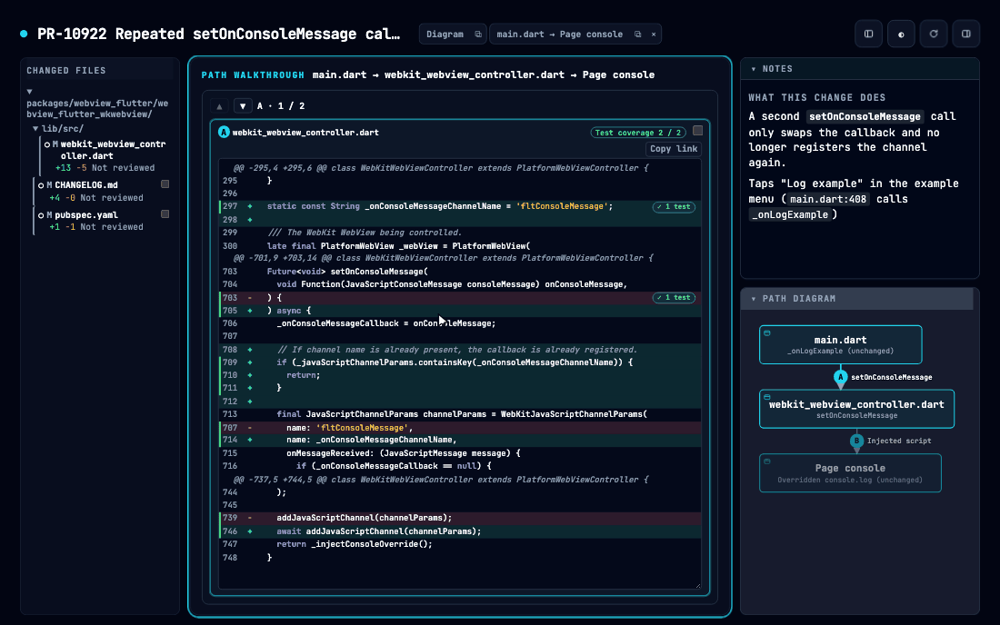

*Tick a diff segment, CHANGELOG.md and two open questions; after a reload they are all still ticked.*

### Refresh a report

The refresh button (↻) in the toolbar copies a command that reruns the report, with the ticket key, the repo and the open-question items you ticked (for example `--done 1,2,3`). Paste it into Claude and it continues from the previous report: ticked items are rechecked to see whether they were fixed, and items that still hold keep their wording. After you reload the page, ticks on code lines that did not change and on items that did not change come back automatically. A commit that was not in the previous report gets a "new commit" mark in its node's top-right corner, and a new open question gets "NEW" next to its severity. "Story purpose" is regenerated from the ticket and commits every time; it is neither compared nor marked NEW.


*With items 1 and 3 ticked, the refresh button copies `/archify-review refresh PR-10922 --done 1,3`.*

### Review a range by feature

A release can bring hundreds of commits and files, more than one report can hold. For `/archify-review <sha1>..<sha2>`, the AI first reads every commit in the range and groups them into features by behavior users can see (like tasks under one Scrum story), with non-functional changes such as version bumps, lockfiles, CI and docs in a last group. Before it builds any report, it lists the features (order, name, what users see change, commit count, file count) and waits for you to confirm or edit them.

Each report holds one feature's code, and only the part that survives to `<sha2>`: code added and then deleted or rewritten along the way does not show up. One file can be split across features by hunk. A feature with more than 12 files is split into batches, one report each, numbered like `AC1-1`, `AC1-2` (the repo's initials plus which range this is).

Next to the refresh button is a next-batch button (⏭ plus how many files this feature has left, for example 23; hover for the full description). It copies `/archify-review next AC1-1`; paste it into Claude to build the next report. It also reminds you how many segments in the current batch are still unticked (a reminder only; it does not block you). On a feature's last batch the button shows only the icon and its tooltip names the next feature; once the whole range has been reviewed, it disappears. Pasting the same command twice gives you the same report.

### Switch layouts: MVVM / Flutter / WebView

The toolbar at the bottom right of the main diagram has layout buttons, and the diagram opens in MVVM. Each button arranges the same nodes and connections into a common industry layering, drawn as dashed orange frames with the title inside the top-left corner; connections are rerouted for the new positions. Which buttons appear depends on the project type, which the AI decides from the repo (`meta.platform`, `meta.framework`, `meta.webview`):

- App projects (Flutter, Android, iOS) get MVVM: three columns from left to right, View, ViewModel and Model (Repository, Service). Nodes stack top to bottom within a column, and connections run across between columns. It follows Flutter's official app architecture guide. An empty column still keeps a narrow frame.
- Flutter projects (the repo has a `pubspec.yaml` that depends on flutter, and the change is Dart/Flutter code) also get Flutter: three horizontal bands from top to bottom, UI (Presentation), Logic (Domain, optional) and Data, from the Layered architecture section of Flutter's Architecture concepts docs. Native Android and iOS code does not get this button.
- When the change touches a WebView bridge or web content (merely using a WebView does not count; the project signals are a pubspec dependency on webview_flutter or flutter_inappwebview, Android use of android.webkit.WebView or androidx.webkit, or iOS use of WKWebView), there is also WebView: three bands from top to bottom, Host (native app code), Bridge (JS handlers) and Content (web page), drawing only files changed in the diff. The layer names come from the official docs of Apple, Android and the Flutter WebView packages.

Where each node sits in each layout is decided by the AI from the code and the node's role (for example, code that only draws a screen is View; code that holds state and responds to the screen is ViewModel). After switching, connection labels, badges, popovers, path tabs and reviewed marks all work as before. The layout is not saved in the browser; the page always reopens in MVVM.

### Zoom the main diagram

The slider in the diagram toolbar zooms up to 400%; on a laptop trackpad you can also spread or pinch two fingers to zoom around the cursor. Once zoomed in, two-finger scroll or drag to pan; the diagram cannot be dragged out of bounds. Zooming back to 100% returns to the size that exactly fits the frame. Switching layouts resets the zoom to 100%.

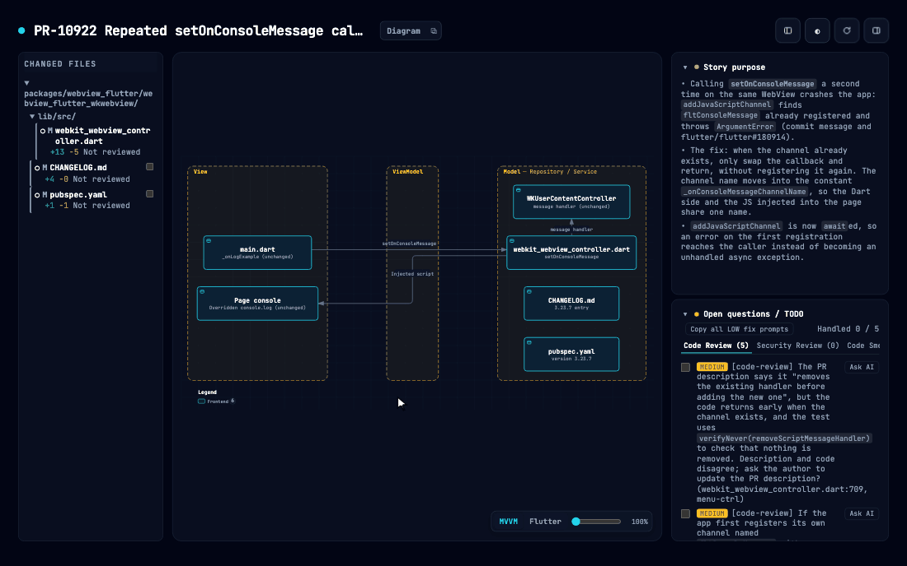

*Drag the slider to 220% and back; spread two fingers over a node to zoom in, scroll with two fingers to pan, then pinch back to 100%.*

### 5. Copy links

The report has four places that copy a link, in two groups: three that point at code and one that points at a view.

#### Links to code

The link looks like this. `file`, `lines` and `commit` say which file of which commit and which lines (`-` are old-file line numbers, `+` new-file line numbers):

```
file:///…/review.html?report=PROJ-123#ref=hop&tab=…&edge=…&file=<repo path>&lines=-a..-b,+c..+d&commit=<sha>
```

Best use: paste it to an AI agent to dig further. The agent can fetch the code with `git show <commit>:<file>` (`+` lines) and `git show <commit>^:<file>` (`-` lines) and then answer your question. Opened in a browser, the report also lands on that path and segment and highlights the lines.

**1. `⧉` next to a tab label (the whole path)**

Where: to the right of every tab label, including the "Diagram" tab. It copies the whole path tab, for example `?report=PR-10922#ref=tab&tab=path-menu-ctrl-page`.


*Click the ⧉ next to a tab; the clipboard contents are shown below.*

**2. "Copy link" on a code block (the whole diff)**

Where: at the top right of every diff or code snippet in a path tab. It copies the whole block, for example `#ref=hop&tab=path-menu-ctrl-page&edge=menu-ctrl&file=…/webkit_webview_controller.dart&lines=-703..-739,+295..+748&commit=12b43a192e`.


*Click "Copy link" above the block; the link carries the file, the lines and the commit.*

**3. "Copy link" that appears after selecting diff lines (only the selected lines)**

Where: drag to select text in a diff and a button appears next to the selection. It copies only the selected lines, for example `…&lines=+708..+710&commit=12b43a192e`.


*Select lines in the diff and press the "Copy link" that appears; `lines` covers only the selection.*

#### Links to a view

This link only records how the view is arranged and points at no code, so an AI agent cannot recover any content from git with it. Best use: send it to a teammate or keep it for yourself; opening it brings back the same view.

**4. "Copy link" on the semantic passport (focused node)**

Where: at the top right of the semantic passport that pops up when you click a node on the main diagram. It copies the focused-node state, for example `#focus=ctrl`; if you are tracing upstream or downstream, it adds `&reach=up` or `&reach=down`.

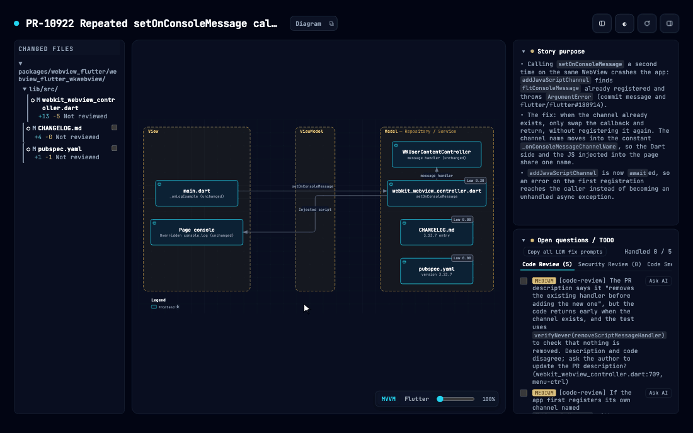

*Click a node to open its semantic passport, then press "Copy link".*

## License

MIT, see [LICENSE](LICENSE). Adapted from [archify](https://github.com/tt-a1i/archify) with the original author's copyright notice kept; third-party font licenses are in `skills/archify-review/THIRD_PARTY_NOTICES.md`.
