[English](README.md) | 繁體中文

> 安裝：`/plugin marketplace add phelixtw/claude-plugins`，再 `/plugin install archify-review@phelix-plugins`，並安裝 code-review-graph：`uv tool install code-review-graph`（只裝 CLI；不要執行它的 `install` 子指令，那會改寫目標 repo 的 `.mcp.json`、`.claude/` 與 `CLAUDE.md`）；使用：`/archify-review`。`review-kit` 內附 macOS（arm64、x86_64）與 Linux（amd64、arm64）執行檔；其他平台需安裝 Go，Windows 需用 WSL 或 Git Bash。產生報告後的 `visual-check` 需要 Chrome 或 Chromium（找不到時設 `ARCHIFY_CHROME`）。

# Archify Review：Code Review 報告

這份報告由 `/archify-review` skill（以開源的 archify 為基礎）產生，把一張 Jira 票（例如 PROJ-123）的 commit 整理成一份可互動的 HTML：架構圖、逐條路徑的 diff 說明、待確認清單，全部在同一個檔案裡。

## 報告檔放哪裡

所有報告共用一份頁面 `~/archify-review/review.html`，每張票只多一個資料檔 `~/archify-review/reports/<票號>.js`（圖、檔案樹、diff、說明文字與待確認清單都在裡面）。用 `review.html?report=PROJ-123` 開啟，換票號就換報告。想保留某一版，複製那張票的 `.js` 檔即可。

## 目的

把一張 Jira 票或一組 commit 的改動畫成可互動的架構圖，reviewer（通常是工程師）照著流程一步一步看 diff；審完列出 Code Review、Security、Code Smell 三類待辦，每一項都能一鍵複製 prompt 交給 AI 修。Reviewer 不必先自己拼湊「這次到底改了什麼、為什麼改」，可以直接從圖與說明進入程式碼。

## 功能

1. 輸入 Jira 票、commit，或一段 commit 範圍（`<sha1>..<sha2>`）都可以；給 Jira 票時，會一併讀 parent Story 裡的 Figma、多語系與 GA 資料，但說明聚焦在這張票的改動目的。範圍太大時，依使用者看得到的功能切開，一次審一個 Feature，只顯示留到範圍最後的程式碼。
2. 變更檔案樹加架構圖。App 專案預設用 MVVM 分層呈現，可切換 Flutter、WebView 版面。
3. 逐條路徑看 diff；測試覆蓋直接標在每段 diff 上：改到的函式在行旁有色條標出有沒有測試，第一行的標籤點開可以看到為什麼要測、由哪些測試涵蓋，以及 Given / When / Then 測試案例，沒有測試的函式附上建議補的案例。測試檔本身不會出現在報告裡。同一個檔案被多個 commit 改過，也只顯示一份淨改動。
4. 每段 diff 都能勾「看過」，檔案樹跟著顯示看過進度；狀態存在瀏覽器，重新整理、關掉分頁或換別張票再回來都還在。
5. 待辦分成 Code Review、Security、Code Smell 三個分頁，依風險分級排序；LOW 項目按「AI Fix」、MEDIUM 以上按「Ask AI」，都會複製對應的 prompt。
6. 每個位置都能複製參照連結，貼給 AI 或同事就能定位到那段程式碼或那個畫面。
7. 亮色、暗色主題，預設跟隨系統；報告產生後由 `visual-check` 自動檢查版面。
8. 每個有改動檔案的節點右上角有爆炸半徑徽章（高／中／低加分數，由 [code-review-graph](https://github.com/tirth8205/code-review-graph) 算出）；點節點，浮窗的「爆炸半徑」分頁列出分數組成、受影響的呼叫者與缺少測試的函式。

## 使用順序

### 1. 先看大架構

打開 HTML 後，先看中間的主圖：這次改動涉及哪些元件、元件之間靠什麼呼叫。點任一節點，會浮出該元件的角色、任務與需要知道的概念。


*點節點，看這個元件在這次變更裡負責什麼。*

本頁動圖用的是開源專案 [flutter/packages](https://github.com/flutter/packages) 的 PR #10922（commit `12b43a192e`，修正重複呼叫 `setOnConsoleMessage` 會當掉）產生的報告。

### 2. 了解 Story 目的

右欄上方的「這張 Story 的目的」說明這張票要解決的問題。先讀完這一塊，後面看 diff 才知道哪些改動是有意為之。

### 3. 釐清待確認問題

右欄下方的「待確認問題 / TODO」列出 AI 在整理過程中發現、需要人決定的事項。產生報告時，skill 會先切換到該任務的專案 repo 與 branch（記下原 branch、做完切回；工作樹有未提交修改時不會 stash 或丟棄，改為詢問你，無法詢問就略過 `/security-review` 並在清單註明），再派 subagent 對同一批 commit 分別跑 Claude Code 內建的 `/code-review`、`/security-review`，以及依內附的 [ponytail-review](https://github.com/DietrichGebert/ponytail)（MIT）規則找過度設計，把發現的問題收進這份清單（卡片上方用 Code Review／Security Review／Code Smell 分頁切換；Code Smell 只挑能刪掉的程式碼、可以換成標準庫或平台原生功能的手寫實作、只有一個實作的抽象，依修改風險分級，每項寫出要砍什麼、用什麼取代），每一項標出嚴重度（high / medium / low 標籤；`review-check` 會檢查嚴重度與排序），並依嚴重度由高到低排序；每一項也標出 `檔案:行號`，並附上對應的流程（`連線 id`）。這份清單的目的就是蒐集「待確認問題 / TODO」，讓 reviewer 決定要不要處理，而不是直接下判決。環境沒有 `/code-review`、`/security-review` 時（例如 Codex）會略過，並在清單中註明。每一項前面有勾選框，勾了代表已處理；LOW 項目有「AI Fix」按鈕，MEDIUM 以上有「Ask AI」按鈕，按了都會複製對應的 prompt 並跳出提示（卡片上也有「複製全部 LOW 修正 prompt」，只複製目前分頁的項目），把該問題、檔案行號與修正指示複製給 AI coding agent。右上角的計數（已處理 N / 6）跟著勾選更新。兩張卡片在畫面夠寬時（1100px 以上）排在圖的右邊，圖可以用滿整個高度；每張卡片標題前的 ▾ 可以單獨收合，另一張就接手空間，工具列最右邊的面板圖示則收合整個右欄。收合狀態會記住；比較窄的畫面，卡片排在圖下方。選擇存在瀏覽器的 localStorage，重新整理後還在（見下方「狀態會保留」）。

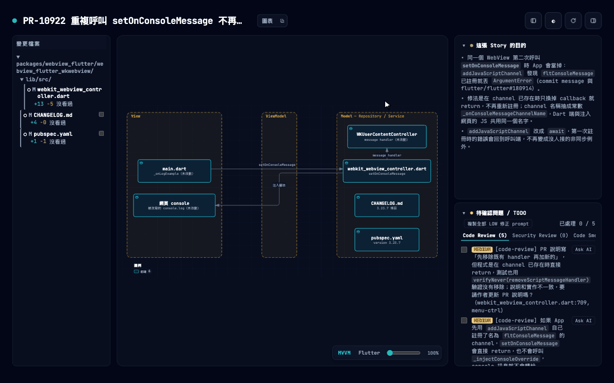

*待確認項目帶嚴重度標籤；按 LOW 項目的「AI Fix」會複製 prompt 並跳出「已複製」，再勾兩項，計數變成 2 / 5。*

### 4. 逐個擊破：Check code change

左側是變更檔案樹，每個檔案旁有「沒看過 / 部分看過 / 看過」狀態。檔案的狀態由引用它的流程決定，流程勾完，檔案就會變成看過；沒有流程引用的檔案（例如 CHANGELOG.md）旁邊有自己的勾選框。

工具列最左邊的面板圖示可以收合檔案樹，把寬度讓給圖或 diff；再按一次展開。

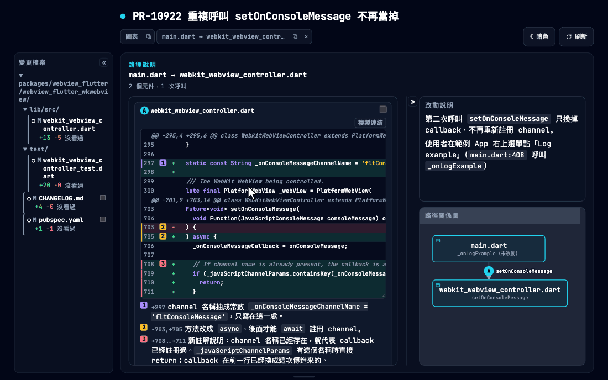

*收合檔案樹，diff 變寬；再按一次展開。*

在主圖上點路徑（連線）或節點，浮窗裡的「查看改動」會開出一個新分頁，專門講這條路徑；節點的浮窗只列檔案和改了什麼，diff 在分頁裡看。

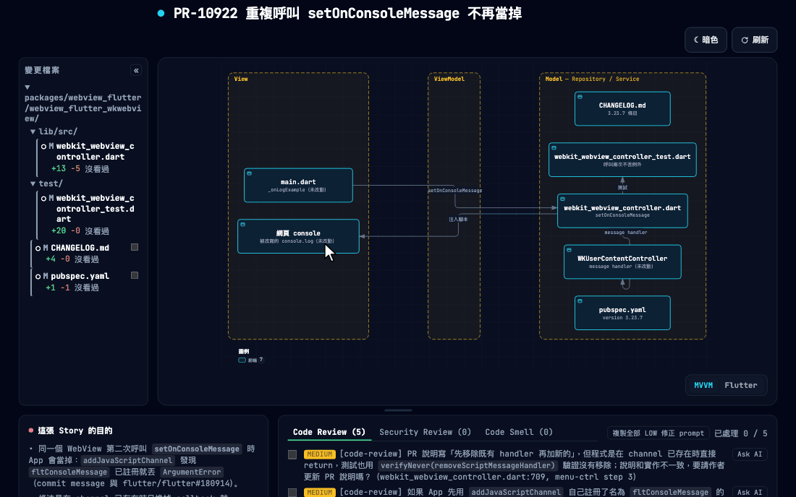

*點連線，再按「查看改動」。*

路徑分頁裡，每一段（A、B、C…）的 diff 右上角都有「看過」勾選框，標題是這段 diff 的檔名。勾完後，左側檔案樹的狀態同步改變。檔案的 diff 只掛在圖上的節點、沒有分給任何連線時，也會接在這條路徑的最後一段，一樣有勾選框。

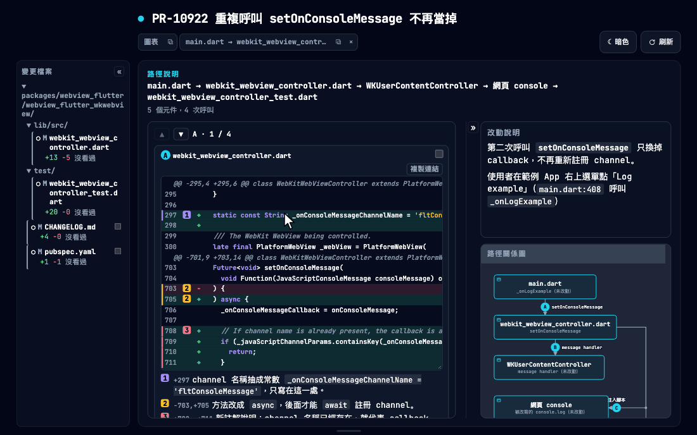

*逐段勾選，左側檔案由「沒看過」變成「部分看過」，再變成「看過」。*

沒有任何連線的節點（例如只改了 CHANGELOG.md 或 pubspec.yaml 的節點），點節點後一樣可以「開新分頁」，分頁裡有它的 diff 和勾選框，右欄的改動說明是這個檔案的摘要。在檔案樹點這類檔案的檔名，也會直接開到它的分頁。

路徑分頁的右欄放「說明」與「路徑關係圖」，位置和圖表頁的卡片欄相同。兩區標題前的 ▾ 可以各自收合；在路徑分頁按工具列最右邊的面板圖示，會收合整個右欄，把寬度讓給 diff，所有路徑分頁共用同一個收合狀態。


*收合右欄的說明與路徑關係圖，diff 變寬；再按一次展開。*

檔案樹和右欄都收合時，diff 會改成左右對照（side-by-side）：左邊是舊版、顯示舊行號，右邊是新版、顯示新行號，刪除與新增的行並排對齊；任一邊展開就回到原本的單欄 diff。複製連結和勾選在兩種模式下都一樣能用。

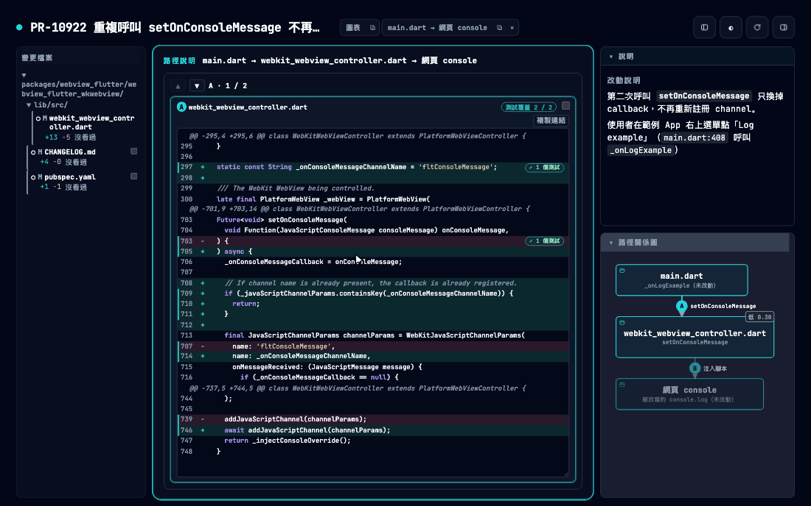

*先收合檔案樹、再收合右欄，diff 變成左舊右新的對照；展開檔案樹後回到單欄。*

#### 看每段 diff 的測試

測試覆蓋直接標在 diff 上。每個改到的函式，它的行在左邊有一條色條：綠色是有測試（新測試或既有測試），紅色加淡紅斜線底是沒有測試，灰色是已刪除，一眼就看得出哪幾段沒測到。函式第一行的右端有一顆小標籤（`✓ 1 個測試`、`✗ 沒有測試`、`已刪除`），點它會在那一行旁邊打開說明框：最上面是「為什麼要測」，說這段程式錯了誰會受影響；接著每個測試寫成 Given / When / Then 三行，測試只是間接呼叫到時標「經 某函式」；沒有測試的函式列出「建議補的案例」。按 Esc 或點旁邊就關掉，打開和關掉都不會捲動頁面。檔名那一列的「測試覆蓋 N / M」是這一段有測試的函式數，全部有測試是綠色，否則是橘色。diff 下方不再列任何清單。測試檔本身不畫成節點、不列在檔案樹，也沒有自己的 diff；對測試程式碼的 review 意見仍在待確認清單裡。

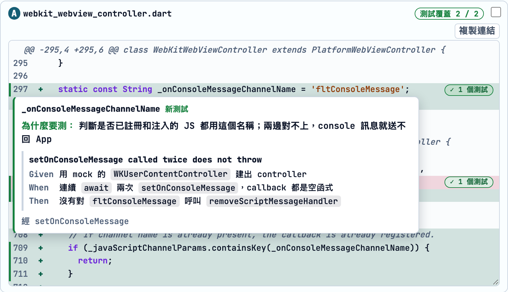

*`setOnConsoleMessage` 兩個改動的函式都有新測試。點常數 `_onConsoleMessageChannelName` 的標籤，說明框寫出為什麼要測、那個測試的 Given / When / Then，以及它是經由 `setOnConsoleMessage` 測到的。*

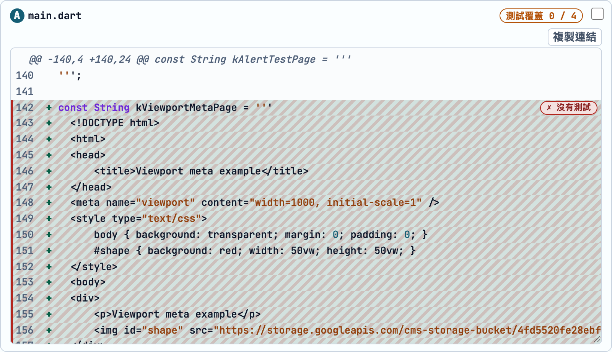

*範例 App 新增的程式都沒有測試：整段是紅色斜線底，標籤寫「沒有測試」，檔名列顯示「測試覆蓋 0 / 4」。*

#### 點選 A / B / C 區域切換 file

一條路徑可能跨好幾個檔案。右下「路徑關係圖」上的 A、B、C 是每一段的位置，點它就切到那一段的 diff；也可以用 `A · 1 / 2` 旁的 ▲ / ▼ 逐段切換。

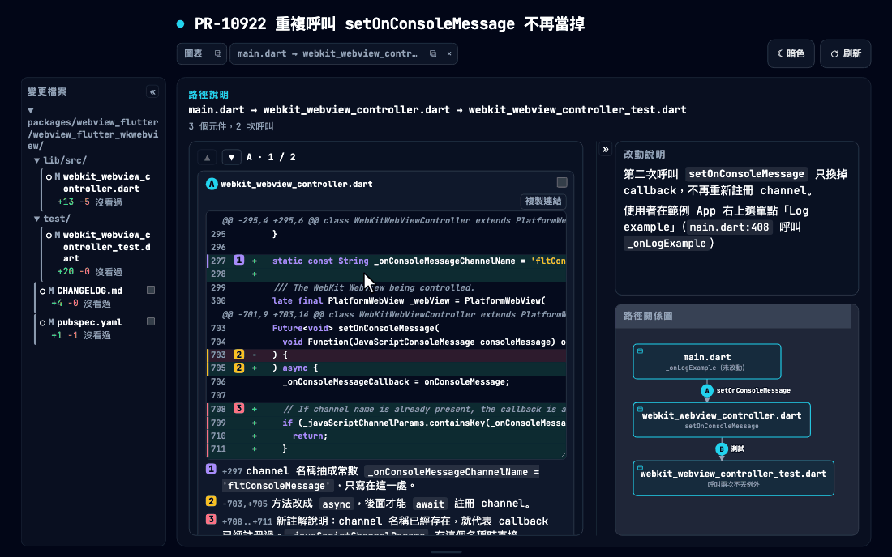

*點路徑關係圖上的 B、A，左側的 diff 跟著切換；每段 diff 都標出測試覆蓋，點函式旁的標籤會打開 Given / When / Then 說明框。*

#### 改動說明與互動關係

右上「改動說明」用一兩句話講這一段改了什麼、使用者在哪裡會觸發；跨兩個檔案的段落多一塊「互動關係」，直接說明這兩個檔案在這次改動裡怎麼搭配，寫出實際的函式名稱和數值。看不懂 diff 時，先讀這一塊。

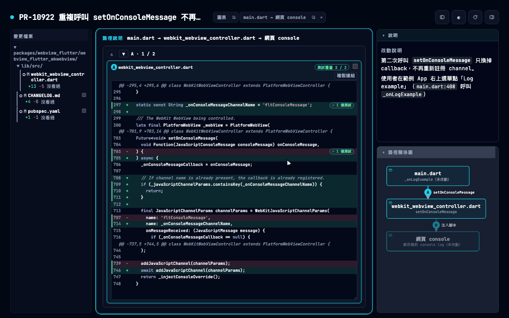

*A 段只有「改動說明」；切到 B 段，多出「互動關係」。*

### 狀態會保留

「看過」勾選與待確認清單的勾選存在瀏覽器的 localStorage（每張票各自一份）。重新整理、關掉分頁再開、切到別張票再切回來，狀態都還在；換瀏覽器或清除瀏覽資料才會消失。

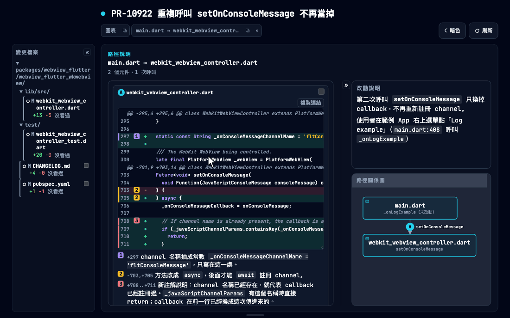

*勾一段 diff、CHANGELOG.md 與兩項待確認問題，重新整理後都還在。*

### 刷新報告

工具列的刷新按鈕（↻）會複製一行重跑指令（含工單號、repo，以及你在待確認清單勾選的項次，例如 `--done 1,2,3`），貼到 Claude 執行後會從上一份報告接著改：勾選的項目會重新確認是否已修好，其他仍成立的項目沿用原文。重新整理頁面後，沒改到的程式行的勾選與沒變的項目的勾選會自動套回。上次報告沒有的 commit，其節點右上角會標「new commit」；新出現的待確認問題會在嚴重度旁標「NEW」。「這張 Story 的目的」每次都從工單與 commit 重新產生，不比對也不標 NEW。


*勾了第 1、3 項，按刷新按鈕，複製的指令是 `/archify-review refresh PR-10922 --done 1,3`。*

### 依功能審查一段範圍

一次版本更新可能有上百個 commit、幾百個檔案，塞不進一份報告。輸入 `/archify-review <sha1>..<sha2>` 時，AI 先讀過範圍內每個 commit，依使用者看得到的行為把它們分成幾個 Feature（像一個 Scrum story 底下的 task），版本號、lockfile、CI、文件這類非功能改動放在最後一組。開始產生報告前，它會先列出 Feature 清單（順序、名稱、使用者看到的改變、commit 數、檔案數），等你確認或修改。

每份報告只放一個 Feature 的程式碼，而且只放留到 `<sha2>` 的部分：中途加上又被刪掉或改寫的程式碼不會出現。同一個檔案可以依 hunk 分給不同 Feature。一個 Feature 超過 12 個檔案時會分成幾批，每批一份報告，編號像 `AC1-1`、`AC1-2`（repo 名稱縮寫加上第幾次範圍）。

工具列刷新按鈕右邊多一個下一批按鈕（⏭ 加上這個 Feature 還剩的檔案數，例如 23；滑鼠移上去會看到完整說明）；按下會複製 `/archify-review next AC1-1`，貼到 Claude 執行就產生下一份，同時提醒這一批還有幾段沒勾（只提醒，不會擋）。一個 Feature 的最後一批，按鈕只剩圖示，提示文字改成下一個 Feature 的名稱；整段範圍都審完時就不顯示。同一行指令貼兩次，拿到的是同一份報告。

### 切換版面：MVVM / Flutter / WebView

主圖右下工具列有版面切換鈕，開啟時預設是 MVVM。各按鈕把同一批節點與連線排成業界通用的分層，每一層是一個橘色虛線框，標題在框內左上角，連線也依新位置重新繞線。按鈕依專案類型而定，AI 看 repo 決定（`meta.platform`、`meta.framework`、`meta.webview`）：

- App 專案（Flutter、Android、iOS）有 MVVM：由左到右三欄 View、ViewModel、Model（Repository、Service），節點在欄內由上往下排，連線橫向穿過欄與欄之間，出自 Flutter 官方 app architecture 指南。沒有節點的欄仍會留一個窄框。
- Flutter 專案（repo 有 `pubspec.yaml` 且依賴 flutter，改動的是 Dart／Flutter 程式碼）多一個 Flutter 按鈕：UI（Presentation）、Logic（Domain，選用）、Data 三條橫帶，由上而下，出自 Flutter 官方文件 Architecture concepts 的 Layered architecture。原生 Android、iOS 程式碼沒有這個按鈕。
- 這次改動有碰到 WebView 的橋接或網頁內容時（只是專案有用 WebView 不算；專案判斷依據：pubspec 依賴 webview_flutter 或 flutter_inappwebview、Android 用到 android.webkit.WebView 或 androidx.webkit、iOS 用到 WKWebView）多一個 WebView 按鈕：Host（原生宿主）、Bridge（橋接）、Content（網頁內容）三條橫帶，由上而下，只畫 diff 裡改到的檔案；分層名稱出自 Apple、Android、Flutter WebView 套件的官方文件。

每個節點在各分層中的位置，由 AI 讀程式碼、依角色決定（例如只畫畫面的是 View，持有狀態並回應畫面的是 ViewModel）。切換後，連線標籤、徽章、浮窗、路徑分頁與看過標記都照常運作。版面不會存到瀏覽器，重新開啟一律回到 MVVM。

### 縮放主圖

主圖工具列的拉條可以把圖放大到 400%；筆電觸控板雙指張開、捏合也能縮放，以游標位置為中心。放大後用雙指滑動或按住拖曳來平移，圖不會被拖出邊界；縮回 100% 就是原本剛好塞滿框的大小。切換版面時縮放會回到 100%。

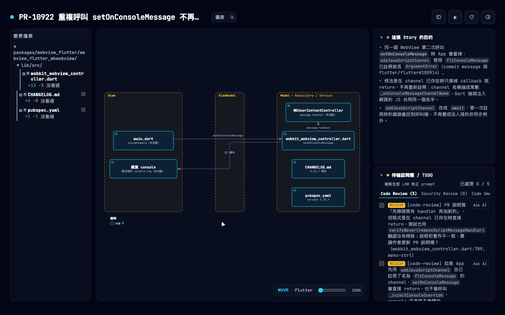

*拉條放大到 220% 再拉回；在節點上雙指張開放大、雙指滑動平移，最後捏合縮回 100%。*

### 5. 複製連結

報告裡共有 4 個「複製連結」的位置，分成兩組：指到程式碼的 3 個、指到畫面狀態的 1 個。

#### 指到程式碼

連結格式如下，`file`、`lines`、`commit` 直接指出是哪個 commit 的哪個檔案、哪幾行（`-` 是舊檔行號，`+` 是新檔行號）：

```
file:///…/review.html?report=PROJ-123#ref=hop&tab=…&edge=…&file=<repo path>&lines=-a..-b,+c..+d&commit=<sha>
```

最適合的用法：貼給 AI 進一步釐清。AI 可以用 `git show <commit>:<file>`（`+` 行）與 `git show <commit>^:<file>`（`-` 行）取回那段程式碼，再回答你的問題。用瀏覽器開啟，報告也會停在那個路徑與那一段，並標出對應的行。

**1. 分頁標籤旁的 `⧉`（整條路徑）**

位置：每個分頁標籤右側，包含「圖表」分頁。複製整條路徑分頁，例如 `?report=PR-10922#ref=tab&tab=path-menu-ctrl-page`。

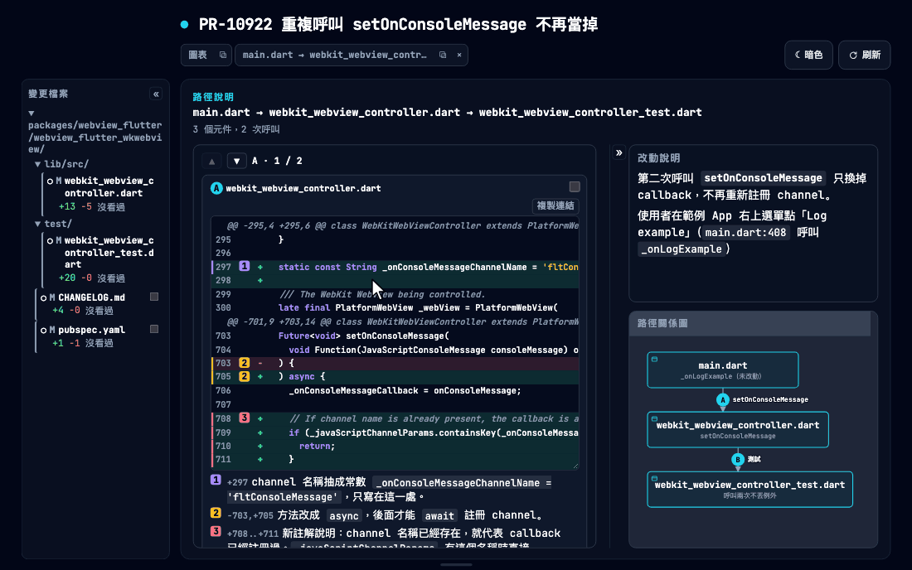

*點分頁旁的 ⧉，下方顯示剪貼簿內容。*

**2. 程式碼區塊的「複製連結」（整段 diff）**

位置：路徑分頁裡每段 diff 或程式碼片段的右上方。複製整個區塊，例如 `#ref=hop&tab=path-menu-ctrl-page&edge=menu-ctrl&file=…/webkit_webview_controller.dart&lines=-703..-739,+295..+748&commit=12b43a192e`。

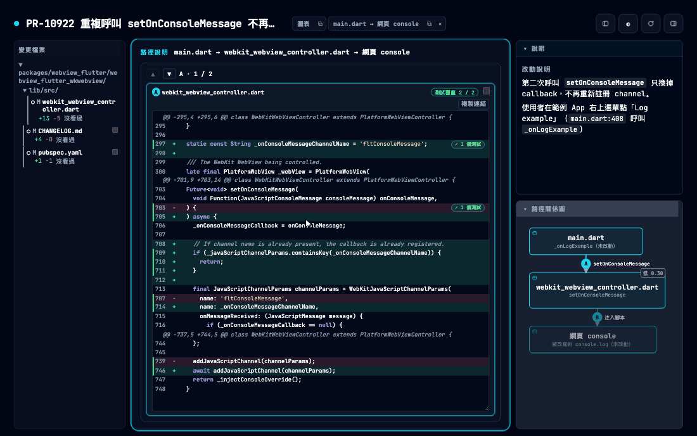

*點區塊上方的「複製連結」，連結帶出檔案、行號與 commit。*

**3. 選取 diff 行後浮出的「複製連結」（只含選到的行）**

位置：在 diff 內拖曳選取文字，選取處旁會浮出按鈕。只複製選到的那幾行，例如 `…&lines=+708..+710&commit=12b43a192e`。

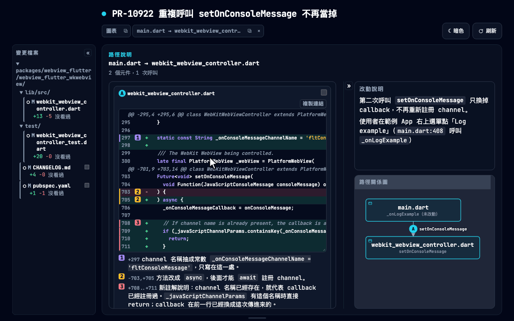

*選取 diff 內的行，按浮出的「複製連結」，lines 只剩選取範圍。*

#### 指到畫面狀態

這組連結只記錄畫面怎麼擺，不指向程式碼，AI 無法用 git 還原內容。最適合的用法：貼給同事或自己日後使用，開啟後會回到同一個畫面。

**4. 語義護照的「複製連結」（聚焦節點）**

位置：在主圖點一個節點，浮出的語義護照右上方。複製節點聚焦狀態，例如 `#focus=ctrl`；若已追蹤上下游，會多一段 `&reach=up` 或 `&reach=down`。


*點節點開啟語義護照，按「複製連結」。*

## License

MIT，見 [LICENSE](LICENSE)。以 [archify](https://github.com/tt-a1i/archify) 為基礎改寫，保留原作者版權聲明；第三方字型授權見 `skills/archify-review/THIRD_PARTY_NOTICES.md`。
